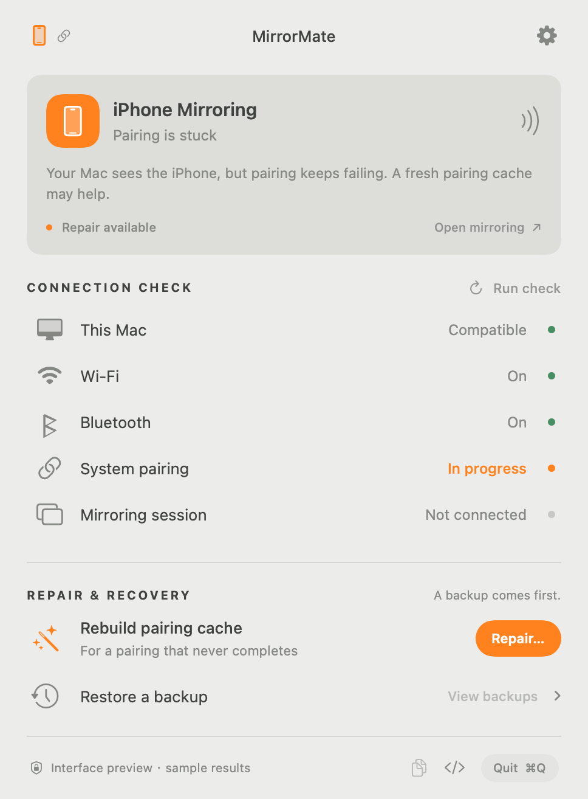

# MirrorMate

**A little help connecting.**

A small, native Mac menu bar companion for iPhone Mirroring. See what is getting in the way, repair a stuck system pairing cache when the checks support it, and keep a way back.



*Interface preview. The example results above are sample data; the app runs actual checks on your Mac.*

## What it does

- Checks Mac compatibility, Wi-Fi, Bluetooth, system pairing, and recent mirroring video activity.
- Offers a pairing-cache repair only after detecting incomplete pairing and repeated `noCompatiblePhone` failures.
- Saves the entire original cache before rebuilding it. Restore a selected backup from the same panel.
- Attempts to roll back if a service restart fails. Neither cache is intentionally deleted during repair or restore.
- Copies a short report without device names, Apple Account details, serial numbers, identifiers, or raw logs.
- Keeps the menu bar panel within its display, with a scrollable body and always-visible header and footer.

Everything runs locally. There is no telemetry, account system, backend, automatic updater, or network request in the diagnostic and repair code. The source-code link opens GitHub in your browser.

## Get started

Download a community build from [Releases](https://github.com/Devin-026/MirrorMate/releases), unzip it, and move **MirrorMate.app** to Applications. Open it and click the iPhone icon in your menu bar.

1. Click **Run check**.
2. Follow the result. Many issues need a setting change or normal iPhone Mirroring setup, rather than a cache reset.
3. If **Repair…** becomes available, review the explanation and choose **Back up & repair**.
4. Finish the authentication prompts in Apple’s iPhone Mirroring app yourself, then lock your nearby iPhone.

Seeing your phone’s screen is the end-to-end success check. “Cache rebuilt” alone does not mean the connection is fixed.

Community builds are ad-hoc signed, **not Apple-notarized**. macOS may block the first open; if you choose to trust this source, use **System Settings → Privacy & Security → Open Anyway**, or build the app locally. Never disable Gatekeeper globally. Release binaries initially cover Apple silicon; the source can also be built for Intel Macs with an Apple T2 chip.

## Scope and compatibility

The app requires **macOS 15 or later**. Apple’s iPhone Mirroring also requires a supported Mac, a compatible nearby iPhone, Wi-Fi and Bluetooth, and the same Apple Account with two-factor authentication. Regional availability and device policies still apply. See [Apple’s requirements](https://support.apple.com/120421).

The cache repair was validated on **macOS 27.2.1 with iOS 27.2.1**, after a Mac migration left system pairing stuck. The native app’s transaction and rollback paths are tested against temporary directories; the real repair was validated separately on that machine. Broad OS/hardware compatibility is not yet established. On a missing or unrecognized cache format, the app does not offer repair. Other versions and failure causes need testing; this is not a universal iPhone Mirroring fix.

Repair closes iPhone Mirroring and restarts the current user’s pairing service. iPhone notifications, widgets, and related continuity data may need to sync again, and mirroring may ask for authorization again. MirrorMate does not change passwords, Apple Account sign-in, VPN, firewall, or network settings. It does not request administrator privileges.

## Backups and recovery

Backups live at `~/Library/Application Support/MirrorMate/Backups`. Use **View backups** to restore an original cache. The cache present before a restore is preserved too. A backup that has already been restored is no longer offered as an original restore point.

If the app cannot inspect the protected pairing folder, use **Allow folder access…** and choose the displayed `group.com.apple.replicatord` folder. Permission errors and unknown cache formats are reported rather than treated as a broken pairing.

If an automatic recovery cannot finish, keep the backup folder, restart your Mac, and use **View backups**. Do not repeatedly reset an already paired device. If the app cannot start or recover the service, include the short report and error text when opening an issue; keep your cache databases private.

## Build locally

You need macOS, Apple’s Command Line Tools or Xcode, and Swift 5.10 or later. There are no third-party package dependencies.

```sh
swift run MirrorMateChecks
bash scripts/build-app.sh arm64
open dist/MirrorMate.app
```

For Intel, run `bash scripts/build-app.sh x86_64`. An Intel binary is not a claim that all Intel machines support iPhone Mirroring; an Apple T2 chip is still required.

Read-only diagnostics:

```sh
swift run MirrorMate --diagnose
```

Render the example interface without touching live pairing:

```sh
swift run MirrorMate --render-preview docs/preview.png
```

Check constrained native layouts, including long messages and small viewports:

```sh
swift run MirrorMate --check-layout
```

`swift run MirrorMate --check-popover` briefly opens and closes a sample menu bar panel to verify its actual window bounds. Neither layout check changes pairing.

## Contribute

Bug reports with the macOS/iOS versions, Mac architecture, and the app’s privacy-filtered report are welcome. Please describe whether the Mac was migrated from another machine. Do not attach cache databases, passwords, device identifiers, or unredacted system logs. See [CONTRIBUTING.md](CONTRIBUTING.md) and [the repair design](docs/REPAIR.md).

Independent community software. Not affiliated with Apple. MIT licensed.
