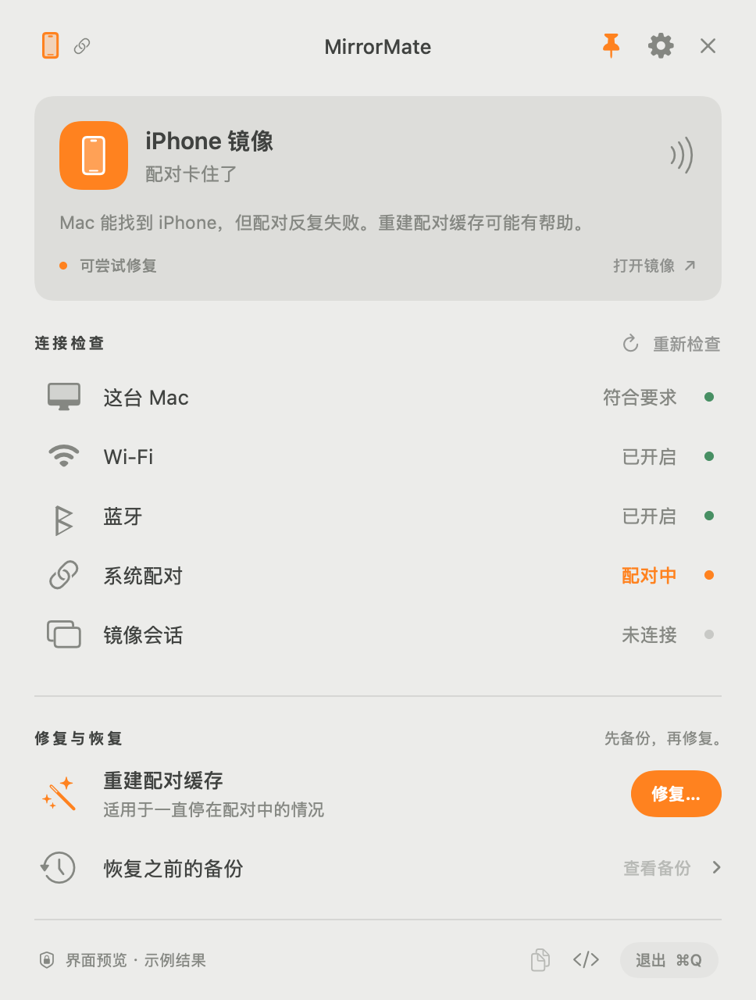

# MirrorMate

[English](README.md) · [简体中文](README.zh-CN.md)

**帮你顺利连接 iPhone。**

一个轻量、原生的 Mac 菜单栏助手：检查 iPhone 镜像连接，对符合条件的配对卡住问题提供备份修复，并保留恢复办法。



## 安装与使用

从 [下载页](https://github.com/Devin-026/MirrorMate/releases) 下载 Apple silicon 版本，解压后将 **MirrorMate.app** 放进“应用程序”。打开后，点击菜单栏的 iPhone 图标。

- **图钉**：默认保持打开，点击其他区域也不会收起；取消固定后，恢复点击外部自动收起。
- **×**：收起面板，助手继续留在菜单栏；再次点击菜单栏图标也可以收起。
- **齿轮**：选择“跟随系统”“简体中文”或“English”，也能调整保持打开的设置。偏好保存在本机，切换立即生效。
- **重新检查**：查看 Mac 兼容性、Wi-Fi、蓝牙、系统配对和最近镜像画面。检查只读，不更改设置。

如果发现配对反复失败且一直未完成，才会启用“修复…”：

1. 阅读修复说明，选择“备份并修复”。
2. 助手保存完整原缓存，再重启当前用户的配对服务。
3. 在 Apple 的 iPhone 镜像窗口中，由你本人完成密码输入和手机解锁确认。
4. 再将 iPhone 锁屏放在附近，以实际看到手机画面为成功。

“缓存已重建”不等于镜像已经连通。如果仍失败，可以在“查看备份”里恢复；恢复前的当前缓存也会保留。

## 适用范围

应用需要 macOS 15 或更新版本。iPhone 镜像本身还需要兼容 Mac、附近的兼容 iPhone、Wi-Fi、蓝牙，以及开启双重认证的同一个 Apple 账户。地区和设备管理策略也可能影响使用，详见 [Apple 官方要求](https://support.apple.com/zh-cn/120421)。

当前实际验证的缓存修复案例是 macOS 27.2.1 / iOS 27.2.1，发生在 Mac 迁移后的持续配对故障。不是所有连接问题都能靠重建缓存解决；遇到无法读取或不能识别的格式，不提供修复。其他版本需要社区继续验证。

这是尚未经过 Apple 公证的社区预览版。若 macOS 阻止首次打开，请在确认信任此项目后，通过“系统设置 → 隐私与安全性 → 仍要打开”批准，或自行从源码构建；无需全局关闭系统安全保护。

## 数据与备份

诊断和修复都在本机运行，没有遥测、账户系统或诊断上传。复制报告时不会包含设备名、Apple 账户、序列号、设备标识或原始日志。

备份位于 `~/Library/Application Support/MirrorMate/Backups`。缓存备份可能包含个人连续互通信息，请保留在本机，不要上传到公开 Issue。

修复会关闭 iPhone 镜像并重启配对服务，通知和小组件可能需要重新同步，镜像可能需要重新授权。它不会修改 Apple 账户、密码、VPN、防火墙或网络设置，也不需要管理员权限。

## 开发与反馈

安装 Apple Command Line Tools 或 Xcode 后，使用 Swift 5.10 或更新版本构建，无第三方包依赖：

```sh
swift run MirrorMateChecks
bash scripts/build-app.sh arm64
open dist/MirrorMate.app
```

测试使用临时目录和模拟服务，不重置开发者现有配对。`--check-layout` 验证中英文及不同高度；`--check-popover` 会短暂打开一个示例弹窗，检查真实窗口边界和图钉行为。

欢迎通过 [连接问题表单](https://github.com/Devin-026/MirrorMate/issues/new/choose) 反馈系统版本、是否迁移过 Mac，以及助手复制的报告。发布前请检查报告，勿附上密码或缓存数据库。

独立社区软件，与 Apple 无隶属关系。采用 [MIT 许可证](LICENSE)。
